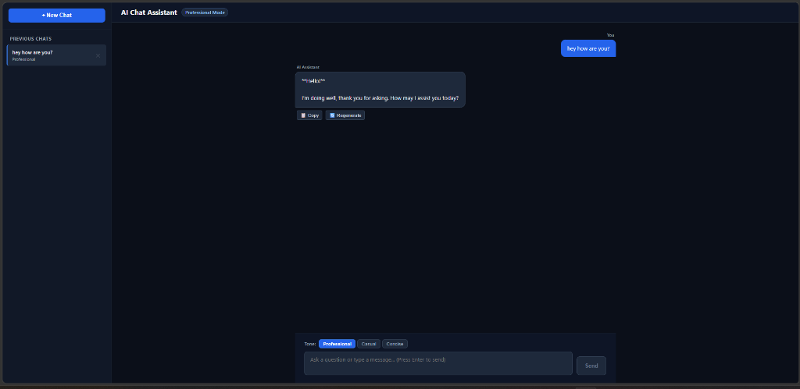
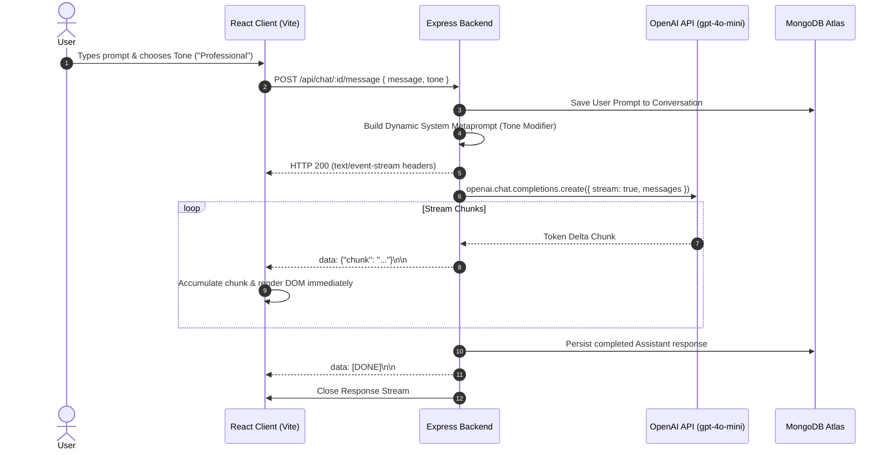

# AI Chat Assistant (MERN + SSE Streaming)

> Production-ready real-time conversational AI assistant built with React (Vite), Node.js/Express, MongoDB Atlas, and the official OpenAI SDK. Designed for the Quantiphi Assessment.

[](https://nodejs.org/)
[](https://react.dev/)
[](https://vitejs.dev/)
[](https://www.mongodb.com/)
[](https://platform.openai.com/)

---

## Live Demo Output



---

## 1. Architectural Overview & Data Flow

The application uses **Server-Sent Events (SSE)** for unidirectional real-time token streaming over standard HTTP. It avoids polling, artificial timers, and WebSocket connection overhead.



---

## 2. Core Features

### A. Real-Time Streaming (SSE)
- AI responses stream token-by-token directly from OpenAI to the UI.
- Consumed on the frontend using standard `fetch()` and `ReadableStreamDefaultReader`—no external streaming packages required.
- Implements abort/disconnect detection (`req.on("close")`) on the backend to avoid wasting LLM tokens if the user navigates away.

### B. Dynamic Tone Steering (Metaprompting)
Users can toggle between three personas on the fly. The backend injects the corresponding system instruction into the conversation context:
- **Professional**: Authoritative, structured, and formal language with clear formatting.
- **Casual**: Friendly, warm, conversational, and approachable tone.
- **Concise**: Direct and brief answers stripped of filler or pleasantries.

### C. Persistent Thread History
- Stored in a single, high-performance MongoDB collection (`Conversation`).
- Auto-generates conversation titles from the initial user prompt.
- Left sidebar enables seamless thread retrieval, switching, and deletion.

### D. Senior-Level Value-Add Features
1. **In-Place Response Regeneration**:
   - `POST /api/chat/:id/regenerate` pops the last assistant message from history, re-invokes the model with existing context, and streams the new response directly into the current bubble.
2. **One-Click Message Copy**:
   - Built into each AI bubble with native Clipboard API integration and visual confirmation (`✓ Copied`).

---

## 3. Tech Stack

| Domain | Technology | Justification |
| :--- | :--- | :--- |
| **Frontend** | React 18, Vite | Sub-millisecond HMR, zero configuration overhead, native React hooks. |
| **Styling** | Custom Scoped CSS | Zero runtime styling overhead, clean dark theme, responsive layout. |
| **Backend** | Node.js, Express.js | Lightweight event-driven I/O ideal for managing concurrent HTTP streams. |
| **Database** | MongoDB & Mongoose | Flexible document model matching multi-turn nested conversational arrays. |
| **AI Integration** | Official OpenAI Node.js SDK | Native AsyncIterable stream handling, model flexibility (`gpt-4o-mini`). |
| **Streaming** | Server-Sent Events (SSE) | Standard HTTP/2 protocol, native proxy traversal, lower overhead than WebSockets. |

---

## 4. Project Directory Structure

```text
quantiphi/
├── client/
│   ├── src/
│   │   ├── components/
│   │   │   ├── Sidebar.jsx        # History list, thread selector, New Chat
│   │   │   ├── ChatWindow.jsx     # Scrollable message area + auto-scroller
│   │   │   ├── MessageBubble.jsx  # User/AI bubbles with Copy & Regenerate
│   │   │   ├── ChatInput.jsx      # Auto-focus textarea + Enter-to-send
│   │   │   └── ToneSelector.jsx   # Professional / Casual / Concise switch
│   │   ├── App.jsx                # State orchestration & SSE reader
│   │   ├── main.jsx               # React entry point
│   │   └── style.css              # Modern dark-mode responsive layout
│   ├── index.html
│   ├── vite.config.js
│   └── package.json
│
├── server/
│   ├── models/
│   │   └── Conversation.js        # Mongoose schema (messages, tone, title)
│   ├── routes/
│   │   └── chatRoutes.js          # REST & SSE streaming endpoints
│   ├── services/
│   │   └── aiService.js           # OpenAI client & dynamic tone prompts
│   ├── server.js                  # Express setup, CORS, and MongoDB init
│   ├── .env.example               # Environment template
│   ├── .env                       # Credentials (git-ignored)
│   └── package.json
│
├── .gitignore                     # Ignores node_modules, dist, and .env
└── README.md
```

---

## 5. API Specification

| Method | Endpoint | Description | Request Body | Response |
| :--- | :--- | :--- | :--- | :--- |
| `GET` | `/api/health` | Health check & DB connection state | None | `{ status, database }` |
| `GET` | `/api/conversations` | List previous chat threads | None | `Array<ConversationSummary>` |
| `GET` | `/api/conversations/:id` | Retrieve full message history | None | `ConversationObject` |
| `DELETE` | `/api/conversations/:id` | Delete a conversation thread | None | `{ message, id }` |
| `POST` | `/api/chat/:id/message` | Append prompt & stream AI response | `{ message, tone }` | `text/event-stream` |
| `POST` | `/api/chat/:id/regenerate` | Re-generate last assistant reply | None | `text/event-stream` |

---

## 6. Database Schema (`Conversation`)

```javascript
{
  title: { type: String, default: "New Conversation" },
  tone: { 
    type: String, 
    enum: ["Professional", "Casual", "Concise"], 
    default: "Professional" 
  },
  messages: [
    {
      role: { type: String, enum: ["user", "assistant"], required: true },
      content: { type: String, required: true },
      timestamp: { type: Date, default: Date.now }
    }
  ],
  createdAt: { type: Date, default: Date.now },
  updatedAt: { type: Date, default: Date.now }
}
```

---

## 7. Getting Started

### Prerequisites
- **Node.js**: v18.0.0 or higher
- **npm**: v9.0.0 or higher
- **MongoDB**: Active MongoDB Atlas connection string (or local `mongod` on port `27017`)
- **OpenAI API Key**: Key with active credit quota (or any OpenAI-compatible provider like Groq/OpenRouter)

---

### Step 1: Clone the Repository
```bash
git clone https://github.com/divyanshkumar06/Quantiphi.git
cd Quantiphi
```

---

### Step 2: Configure Environment Variables
Navigate to `server/` and create or edit `.env`:

```bash
cd server
```

Edit `server/.env`:
```env
PORT=5000
MONGO_URI=mongodb+srv://<username>:<password>@cluster0.xxxxx.mongodb.net/quantiphi_chat?retryWrites=true&w=majority
OPENAI_API_KEY=sk-proj-yourActualKeyHere
```

> **Tip for Free/Instant Alternative (Groq):**  
> If your OpenAI account has exhausted credits, you can seamlessly use a free Groq key without any code changes:
> ```env
> OPENAI_API_KEY=gsk_yourGroqKey
> OPENAI_BASE_URL=https://api.groq.com/openai/v1
> OPENAI_MODEL=openai/gpt-oss-120b
> ```

---

### Step 3: Install Dependencies

**Install Backend Dependencies:**
```bash
cd server
npm install
```

**Install Frontend Dependencies:**
```bash
cd ../client
npm install
```

---

### Step 4: Run the Application

Open two terminal windows:

**Terminal 1 (Backend):**
```bash
cd server
npm start
```
*Output will confirm:*
```text
Connected to MongoDB successfully
Server running on http://localhost:5000
```

**Terminal 2 (Frontend):**
```bash
cd client
npm run dev
```
*Frontend will launch at:* `http://localhost:5173`

---

## 8. Senior Engineering Design Decisions & Security

1. **SSE vs. WebSockets**:
   Chat assistants follow a request-response cadence where only the response is streaming. SSE operates natively over HTTP/2, requires no socket handshake, works behind enterprise reverse proxies, and handles reconnection via browser protocols.
2. **Client Disconnection Management (Token Cost Optimization)**:
   The backend attaches a listener to `req.on("close")`. If a user closes the browser tab while the AI is halfway through a 1,000-token response, the server halts consumption from the LLM immediately, cutting downstream token costs.
3. **Graceful Metaprompt Isolation & Injection Defense**:
   System prompts are strictly mapped from a backend enum whitelist (`["Professional", "Casual", "Concise"]`). Malicious client input cannot override or poison the system instructions.
4. **NoSQL / BSON Injection Hardening**:
   All route identifiers are strictly validated via `mongoose.Types.ObjectId.isValid()`, preventing server crashes and casting errors from malformed input.
5. **Memory & Payload DoS Defense**:
   Incoming request bodies are limited to `1mb` via `express.json({ limit: "1mb" })` to protect the event loop against oversized payload attacks.
6. **Security & Secrets Isolation**:
   The API keys are strictly kept on the backend in `.env` and never bundled or sent to the browser. [server/.env](file:///c:/Users/Lenovo/Desktop/quantiphi/server/.env) is git-ignored and never committed to GitHub.
7. **Resilient Error Propagation**:
   Stream errors (such as API 429 quota exhaustion or key invalidation) are surfaced immediately to the UI via an interactive banner, preventing silent failures.
